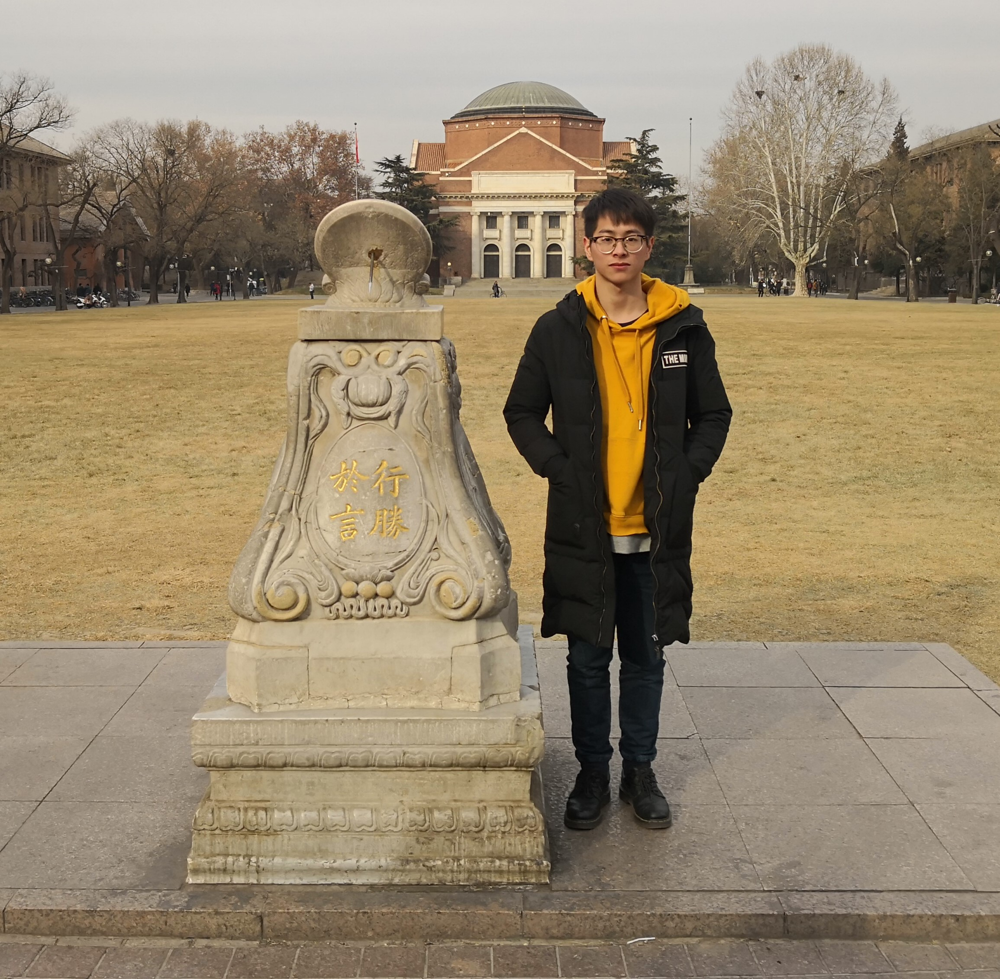
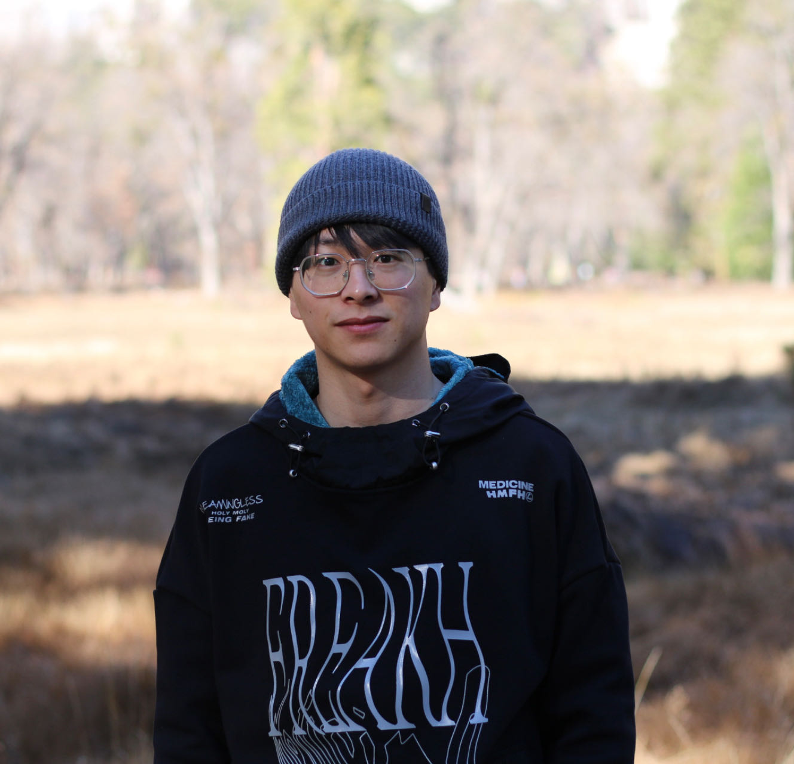
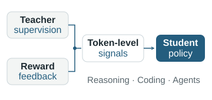
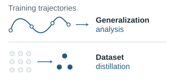
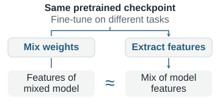

<!-- later try:
https://david-abel.github.io/index.html -->

<section class="profile" aria-labelledby="profile-name" markdown="1">

# Yilan Chen
{: #profile-name}

Ph.D. candidate · UC San Diego

<!-- My research aims to build AI systems that **learn efficiently and generalize reliably**.
{: .profile-goal} -->

<!-- <figure>

<figcaption>2019 at Beijing.</figcaption>
</figure> -->

I am a final-year Ph.D. student in the [Department of Computer Science and Engineering](https://cse.ucsd.edu/) at the University of California San Diego (UCSD), working with Prof. [Arya Mazumdar](https://mazumdar.ucsd.edu/index.html).
During my Ph.D., I have interned at AWS Agentic AI, Google Research, and RIKEN AIP.

<nav class="profile-links" aria-label="Profile links">
  <!-- Icon sources and licenses:  -->
  <a href="mailto:yic031@ucsd.edu">
    
    Email
  </a>
  <!-- <a href="/files/CV_Yilan_Chen.pdf">
    
    CV
  </a> -->
  <a href="https://scholar.google.com/citations?user=6wmzpRIAAAAJ&amp;hl=en">
    
    Google Scholar
  </a>
  <a href="https://github.com/yilanchen6">
    
    GitHub
  </a>
  <a href="https://www.linkedin.com/in/yilan-chen-79285a122/">
    
    LinkedIn
  </a>
  <a href="https://x.com/yilanchen06">
    
    X
  </a>
</nav>

  

</section>
<!-- [[Twitter]](https://twitter.com/yilanchen06)
[[Zhihu]](https://www.zhihu.com/people/yilan-24-8/posts) -->

<aside class="hiring-notice" aria-label="Career opportunities">
  Open to full-time roles
  
Research Scientist, Research Engineer, or Member of Technical Staff in LLM training, reinforcement learning, and AI agents. <a href="mailto:yic031@ucsd.edu">Let’s connect ↗</a>

</aside>

<!-- I am interning at [deep learning theory team](https://aip.riken.jp/labs/generic_tech/deep_learn_theory/) in RIKEN AIP advised by Prof. [Taiji Suzuki](https://ibis.t.u-tokyo.ac.jp/suzuki/) this summer. -->

<section class="research-overview" aria-labelledby="research-interests" markdown="1">

## Research
{: #research-interests}

My research aims to build AI systems that **learn efficiently and generalize reliably**.
I pursue this goal by developing better learning algorithms, establishing their theoretical foundations, and studying how models acquire and transfer knowledge. My current focus is **LLM post-training** for reasoning models and agents.
{: .research-intro}

<article class="research-theme" aria-labelledby="research-post-training" markdown="1">

<figure class="research-visual">
  
</figure>

### LLM Post-training & Agent Learning
{: #research-post-training}

I develop reinforcement learning and on-policy distillation methods that help reasoning models and agents learn more effectively from teacher supervision and task feedback. My work aligns token-level learning signals with task rewards, connects distillation to RL advantage estimation, and uses privileged training information to improve agent learning.

  <a href="https://arxiv.org/abs/2610.14572" title="NeurIPS 2026 PretoPost Workshop">Reward-Aligned Distillation (Preprint 2026)</a>
  <a href="https://arxiv.org/abs/2610.18883" title="NeurIPS 2026 PretoPost Workshop">Token Utility (Preprint 2026)</a>
  <a href="https://openreview.net/pdf?id=R1peldcnUL" title="NeurIPS 2026 PretoPost Workshop">PINT (Preprint 2026)</a>

</article>

<article class="research-theme" aria-labelledby="research-learning-theory" markdown="1">

<figure class="research-visual">
  
</figure>

### Learning Theory & Generalization
{: #research-learning-theory}

I study how data, optimization, and model structure determine learning efficiency and generalization. My work develops generalization bounds through connections between training trajectories and kernel methods, analyzes transformer in-context learning, and establishes guarantees for dataset distillation using compact synthetic datasets.

  <a href="https://arxiv.org/abs/2506.11357">Training Trajectories &amp; Generalization (NeurIPS 2025)</a>
  <a href="https://openreview.net/pdf?id=WI2VpcBdnd">Dataset Distillation (NeurIPS 2024)</a>
  <a href="https://openreview.net/pdf?id=8Ba7VJ7xiM">Loss Path Kernels (NeurIPS 2023)</a>

</article>

<article class="research-theme" aria-labelledby="research-interpretability" markdown="1">

<figure class="research-visual">
  
</figure>

### Interpretability & Knowledge Transfer
{: #research-interpretability}

I investigate what knowledge neural networks acquire and how it is represented and transferred across models and tasks. My work studies relationships between fine-tuned representations, improves automated neuron explanations, and quantifies concepts learned through distillation.

  <a href="https://arxiv.org/abs/2402.03660">Cross-Task Linearity (ICML 2024)</a>
  <a href="https://ieeexplore.ieee.org/stamp/stamp.jsp?arnumber=9864081" title="Quantifying the Knowledge in a DNN to Explain Knowledge Distillation for Classification">Quantifying Knowledge in a DNN (TPAMI 2023)</a>
  <a href="https://arxiv.org/abs/2310.06200" title="NeurIPS 2023 Workshop on Attributing Model Behavior at Scale">Automated Neuron Explanations (NeurIPS Workshop 2023)</a>

</article>

</section>



<!-- ## Preprint -->

## Experience

<article class="experience-entry" markdown="1">
<header class="experience-header">
  <h3>AWS Agentic AI</h3>
  
Jun. – Sep. 2026

</header>

Applied Scientist Intern · Santa Clara, USA

Host: [Vijay Lingam](https://www.linkedin.com/in/vijaylingam)

LLM Post-training: Reinforcement Learning and Distillation

</article>

<article class="experience-entry" markdown="1">
<header class="experience-header">
  <h3>Google Research</h3>
  
Jun. – Sep. 2025

</header>

Student Researcher · New York, USA

Hosts: [Ankit Singh Rawat](https://ankitsrawat.github.io/home/), [Aditya Krishna Menon](https://akmenon.github.io/)

On-Policy Distillation for LLM Reasoning

</article>

<article class="experience-entry" markdown="1">
<header class="experience-header">
  <h3>RIKEN AIP</h3>
  
Jun. – Sep. 2024

</header>

Research Intern · Tokyo, Japan

Advisor: Prof. [Taiji Suzuki](https://ibis.t.u-tokyo.ac.jp/suzuki/)

Theory of Neural Networks and Language Models

</article>

<section class="education" aria-labelledby="education" markdown="1">

## Education

<article class="education-entry" markdown="1">
<header class="education-header">
  <h3>University of California San Diego</h3>
  
Sep. 2022 – Mar. 2027 (expected)

</header>

Ph.D. in Computer Science

Advisor: [Arya Mazumdar](https://mazumdar.ucsd.edu/)

</article>

<article class="education-entry" markdown="1">
<header class="education-header">
  <h3>University of California San Diego</h3>
  
Sep. 2020 – Jun. 2022

</header>

M.S. in Computer Science

<!-- Advisors: [Tsui-Wei (Lily) Weng](https://lilywenglab.github.io/) and [Lam M. Nguyen](https://www.lamnguyen.org/) (IBM Research) -->

</article>

<article class="education-entry" markdown="1">
<header class="education-header">
  <h3>Xi’an Jiaotong University</h3>
  
Aug. 2015 – Jun. 2019

</header>

B.E. in Information Engineering

</article>

</section>

<!-- ## Notes
- [A Note about NTK Derivation](/files/ntk_derivation.pdf)
- [Some Derivations and Proofs about Linearized Networks](/files/linearized_network.pdf) -->

<!-- **Projects**
* [Prototype Selection for Nearest Neighbor](/files/Prototype_Selection.pdf)
* [Coordinate Descent](/files/coord_desc.pdf) -->

## Talks

  <article class="talk-entry">
    <header class="talk-header">
      <h3>Generalization Bound of Gradient Flow through Training Trajectory and Data-dependent Kernel</h3>
    </header>
    <ul class="talk-events">
      <li><time datetime="2025-03">Mar. 2025</time><a href="https://sites.google.com/ucsd.edu/encore-llm/">EnCORE Institute Workshop on Theoretical Perspectives on LLMs</a></li>
    </ul>
  </article>
  <article class="talk-entry">
    <header class="talk-header">
      <h3>Analyzing Neural Networks through Equivalent Kernels</h3>
      <a class="talk-slides" href="/files/LPK_SOCAMS.pdf" aria-label="Slides: Analyzing Neural Networks through Equivalent Kernels">Slides</a>
    </header>
    <ul class="talk-events">
      <li><time datetime="2024-08">Aug. 2024</time><a href="https://tensorworkshop.github.io/RIKENAIP_SJTUCS2024/">RIKEN AIP – SJTU CS Joint Workshop on Machine Learning and Brain-like Intelligence</a></li>
      <li><time datetime="2024-04">Apr. 2024</time><a href="https://www.socams.org/home">Southern California Applied Mathematics Symposium (SOCAMS 2024)</a></li>
    </ul>
  </article>
  <article class="talk-entry">
    <header class="talk-header">
      <h3>Analyzing Generalization of Neural Networks through Loss Path Kernels</h3>
      <a class="talk-slides" href="/files/LPK.pdf" aria-label="Slides: Analyzing Generalization of Neural Networks through Loss Path Kernels">Slides</a>
    </header>
    <ul class="talk-events">
      <li><time datetime="2024-01">Jan. 2024</time>ByteDance</li>
      <li><time datetime="2023-11">Nov. 2023</time>AI TIME</li>
    </ul>
  </article>

## Teaching
- [DSC 212: Probability and Statistics](https://sites.google.com/ucsd.edu/dsc212f24/home), TA, Fall 2024
- [DSC 140B: Representation Learning](https://lilywenglab.github.io/DSC-140B-SP24/), TA, Spring 2024
- [DSC 210: Numerical Linear Algebra](https://lilywenglab.github.io/DSC-210-fa23/), TA, Fall 2023
- [DSC 291: Trustworthy Machine Learning](https://lilywenglab.github.io/dsc-291-sp23/), Tutor, Fall 2021

<!-- ## Courses
- Machine Learning:
  - CSE 250A Probabilistic Reason & Learning  A+
  - CSE 251A ML: Learning Algorithms  A+
  - CSE 251C ML: Machine Learning Theory  A
  - CSE	252A Computer Vision I  A+
  - CSE	257  Search and Optimization A

- Math:
  - MATH 245A	Convex Analysis & Optimization I  A
  - MATH 245B	Convex Analysis & Optimization II  A
  - ECE	269   Linear Algebra and Application A
  - MATH 281A Mathematical Statistics ongoing -->

## Professional Service
- Conference Reviewer: ICML, NeurIPS, ICLR
- Area Chair: ICLR 2026 DeLTa Workshop
- Journal Reviewer: Journal of Optimization Theory and Applications (JOTA)
<!-- - Program Committee: AAAI 2023 Workshop MLmDS -->
